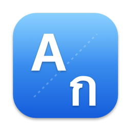

<div align="center">



# RightType for macOS

### พิมพ์ผิดภาษา แก้ให้เอง

แอปเมนูบาร์บน Mac ที่แปลงข้อความพิมพ์ผิดคีย์บอร์ด ไทย ↔ อังกฤษ ให้ถูกต้อง โดยไม่ต้องลบแล้วพิมพ์ใหม่

~~l;ylfu~~ → **สวัสดี**  ·  ~~Cyorb,rN~~ → **ฉันพิมพ์**  ·  ~~้ำสสน~~ → **hello**


[**ดาวน์โหลด**](https://github.com/lungkao/RightType-mac/releases/latest) · [วิธีใช้](#วิธีใช้) · [ติดตั้ง](#ติดตั้ง) · [เครดิต](#เครดิต) · [สนับสนุน](#สนับสนุน)

</div>

---

*English: a macOS menu-bar port of [RightType](https://github.com/k-affan-th/RightType).
It fixes text typed in the wrong keyboard layout (Thai typed on the English layout, or
the reverse) without retyping — live while you type, with a hint you accept by pressing
Tab, or fully automatic. Free, open source, no network code.*

## สิ่งที่แอปทำได้

- **แก้ไทยที่พิมพ์บนแป้นอังกฤษระหว่างพิมพ์** ไม่ต้องเว้นวรรค ประโยคยาวๆ ก็แก้ได้
- **แก้อังกฤษที่พิมพ์บนแป้นไทย** เมื่อพิมพ์จบคำ และสลับแป้นให้ด้วย
- **3 โหมด** ให้เลือกจากเมนู **Aก**: Manual (กด `⇧⌫` เอง) · Suggest (มีป้ายเตือน กด `Tab` เพื่อแก้) · Auto (แก้ให้เองทันที)
- **แก้คำไทยสะกดผิดที่พบบ่อย** เช่น อนุญาติ → อนุญาต ด้วยป้ายให้กด `Tab`
- **เปิดอัตโนมัติตอนเข้าเครื่อง** (ปิดได้จากเมนู)
- ไม่มีโค้ดเชื่อมต่ออินเทอร์เน็ต ไม่เก็บและไม่ส่งสิ่งที่คุณพิมพ์ไปไหน

## ติดตั้ง

1. ดาวน์โหลด `RightType-mac-<เวอร์ชัน>.zip` จากหน้า [Releases](https://github.com/lungkao/RightType-mac/releases/latest) แล้วแตกไฟล์
2. ลาก `RightType.app` ไปไว้ในโฟลเดอร์ **Applications**
3. คลิกขวาที่แอป → **Open** → **Open** (ครั้งแรกครั้งเดียว เพราะแอปยังไม่ได้ลงลายเซ็นจาก Apple
   ถ้าไม่มีปุ่ม Open ให้ไป System Settings → Privacy & Security แล้วกด **Open Anyway**)
4. เปิดสวิตช์ RightType ที่ System Settings → Privacy & Security → **Accessibility**
   (และ **Input Monitoring** ถ้า macOS ถาม) แล้วจะเห็นไอคอน **Aก** บนเมนูบาร์

ต้องใช้ macOS 13 ขึ้นไป (Apple Silicon หรือ Intel)

## วิธีใช้

| ทำอะไร | กดอะไร |
| --- | --- |
| แก้คำล่าสุด (กดซ้ำเพื่อย้อนกลับ) | `⇧⌫` |
| แก้ข้อความที่เลือกไว้ | `⌃⌥Space` |
| รับคำแนะนำจากป้าย | `Tab` |
| เปลี่ยนโหมด / เปิด-ปิดแก้สะกด / เปิดตอนเข้าเครื่อง | คลิกไอคอน **Aก** บนเมนูบาร์ |

## สร้างเอง

ต้องมี Rust และ Xcode command-line tools

```bash
macos/build.sh      # สร้าง macos/build/RightType.app
macos/install.sh    # สร้าง ติดตั้งใน /Applications และเปิดให้
macos/dist.sh       # สร้าง zip แบบ universal สำหรับแจก
```

รายละเอียดเพิ่มเติมอยู่ใน [macos/README.md](macos/README.md)

## ที่ยังไม่มี (เทียบกับเวอร์ชัน Windows)

หน้าตั้งค่า · ตั้งโหมดแยกตามแอป · command palette · แก้ย้อนหลังหลายคำ · หน้าฝึกพิมพ์และสถิติ

## เครดิต

**ระบบแก้ภาษาทั้งหมดเป็นผลงานของ [RightType](https://github.com/k-affan-th/RightType) โดย
[k-affan-th](https://github.com/k-affan-th) และผู้ร่วมพัฒนา** ได้แก่ การแปลงเลย์เอาต์ ไทย ↔ อังกฤษ
การตรวจว่าพิมพ์ผิดภาษา พจนานุกรม การตัดคำไทย และรายการคำสะกดผิด (โฟลเดอร์ `src/` และ `assets/`
ใช้โดยไม่แก้ไข) โปรเจกต์นี้ไม่มีทางเกิดขึ้นได้ถ้าไม่มีงานของพวกเขา — ขอบคุณมากครับ

ส่วนที่เพิ่มเข้ามาสำหรับ macOS อยู่ในโฟลเดอร์ [`macos/`](macos/): ตัวเชื่อม C-ABI (`ffi/`),
แอปเมนูบาร์ที่เขียนด้วย Swift (`App/`), ตัวสร้างไอคอน และสคริปต์ build/install

เอกสารต้นฉบับของเวอร์ชัน Windows อยู่ที่ [docs/README.windows.md](docs/README.windows.md)

## สนับสนุน

ถ้าแอปนี้ช่วยให้คุณพิมพ์ได้สบายขึ้น เลี้ยงกาแฟผู้พอร์ตแอปมาสู่ Mac ได้ครับ ☕

<a href="https://buymeacoffee.com/cheuachatchai"></a>

และถ้าคุณชอบระบบแก้ภาษาตัวนี้ อย่าลืมไปให้ดาว [ต้นฉบับ](https://github.com/k-affan-th/RightType) ด้วยนะครับ

## License

MIT OR Apache-2.0 เหมือนต้นฉบับ — ดู [LICENSE-MIT](LICENSE-MIT), [LICENSE-APACHE](LICENSE-APACHE) และ [NOTICE](NOTICE)
